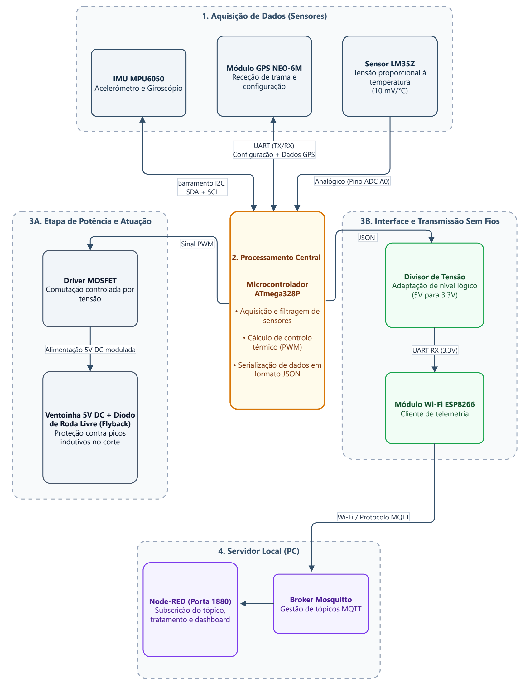
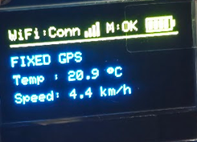
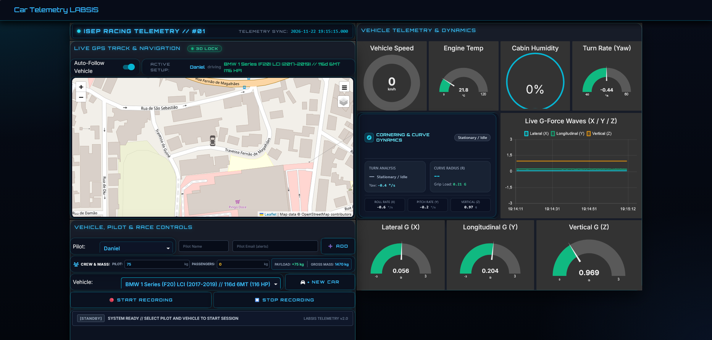
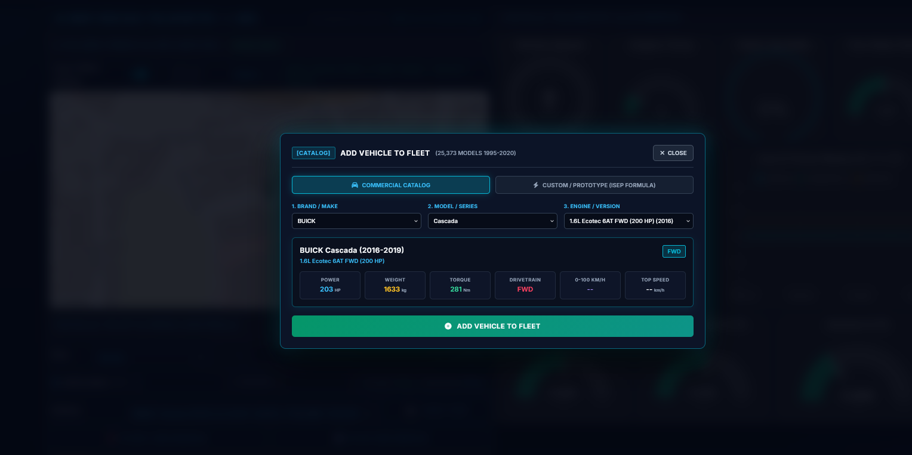
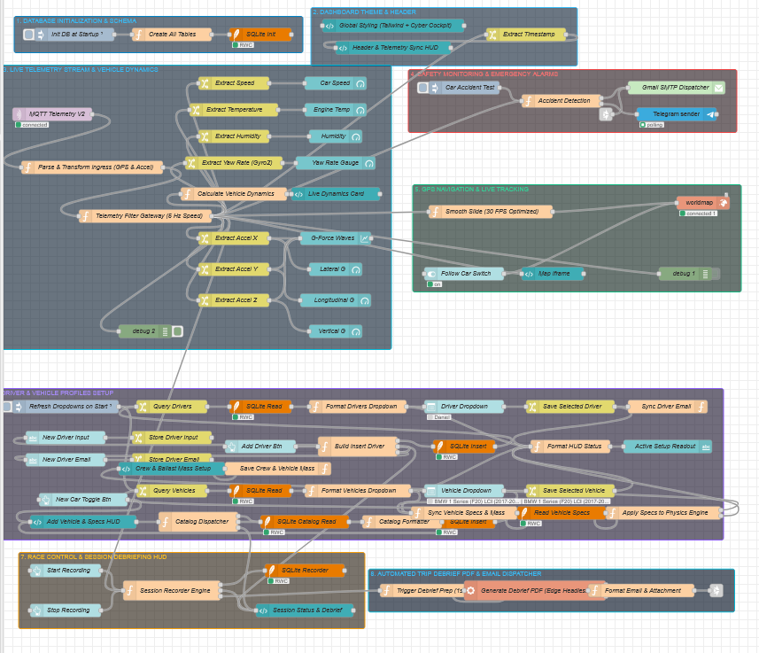
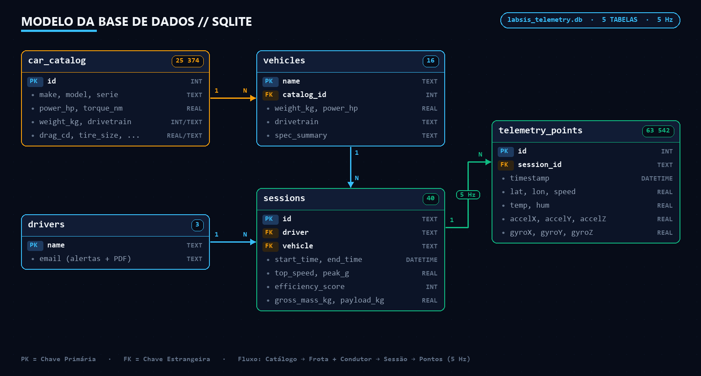
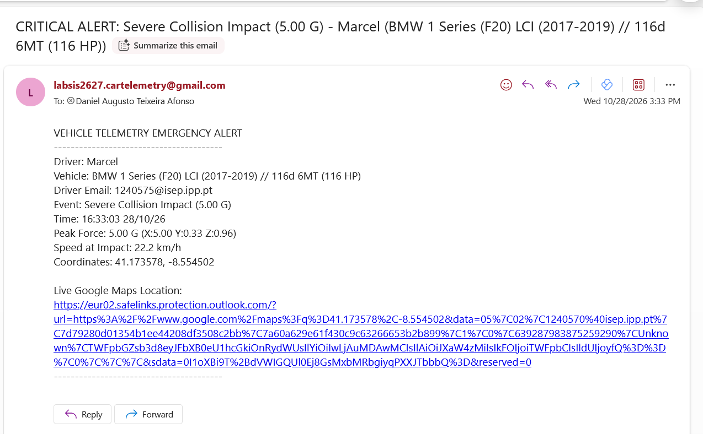
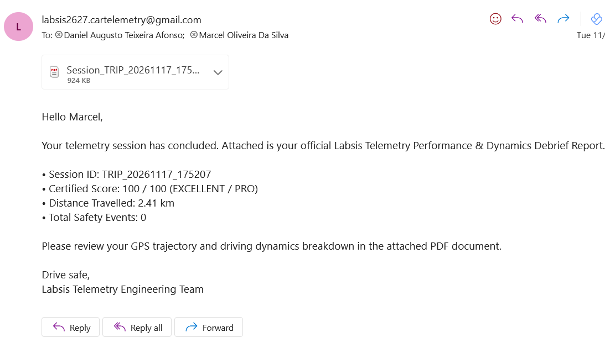
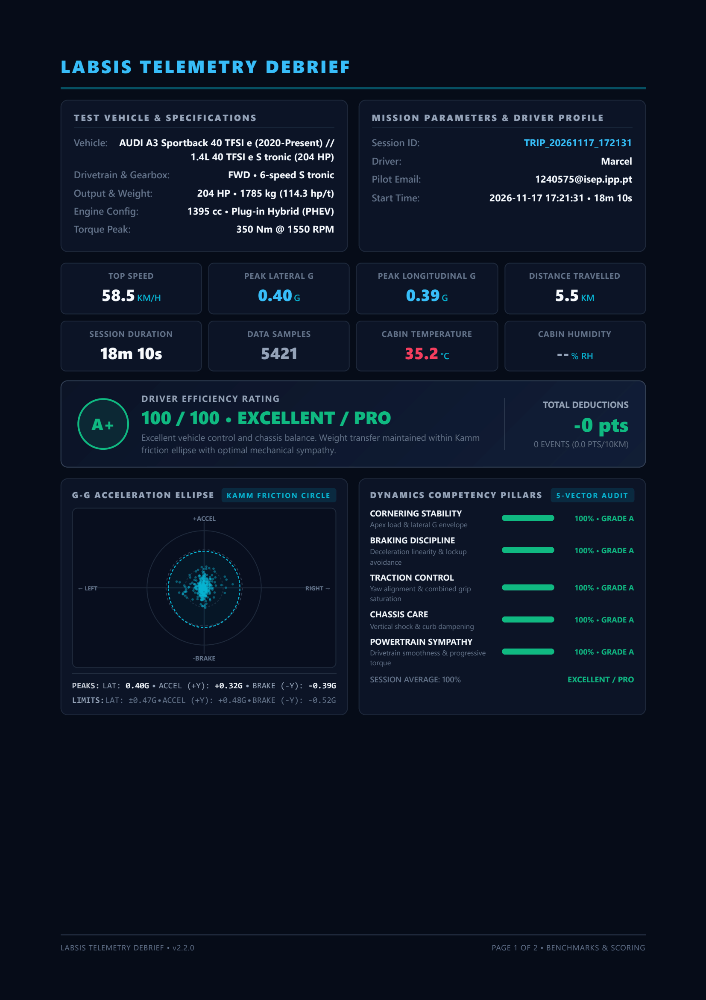
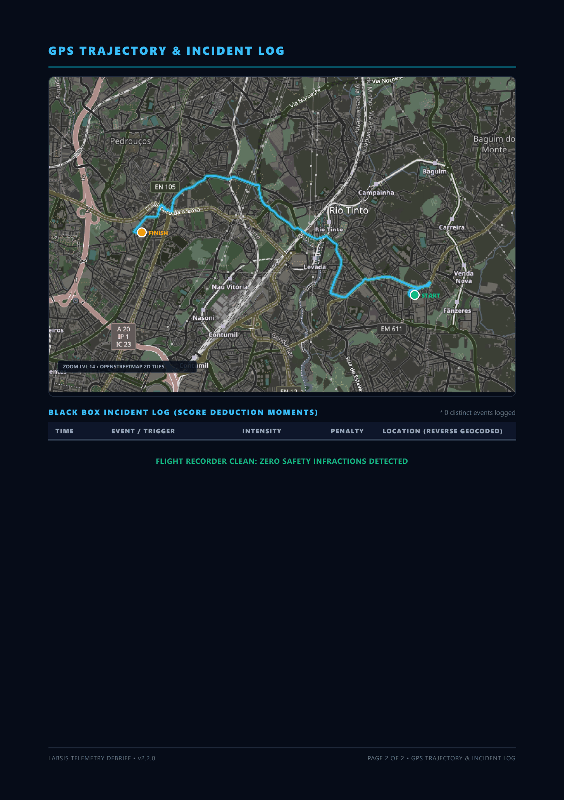

# Sistema de Telemetria Automóvel em Tempo Real (LABSIS)

<p align="left">
  
  
  
  
  
</p>

Sistema embebido *end-to-end* de aquisição, controlo térmico autónomo, transmissão sem fios (MQTT) e visualização em tempo real de parâmetros cinemáticos, geográficos e térmicos de um veículo, desenvolvido no âmbito da unidade curricular de **Laboratório de Sistemas (LABSIS)** da Licenciatura em Engenharia Eletrotécnica e de Computadores (**LEEC — ISEP**).

* **Autores:** Daniel Afonso (1240570) · Marcel da Silva (1240575)
* **Documentação Original:** [Especificação do Projeto (PDF)](./docs/Especificacao_Telemetria_Automovel.pdf)
* **Estado Atual:** Firmware, comunicação sem fios, painel OLED, dashboard Node-RED, base de dados, alertas de acidente e geração automática de relatórios PDF **100% implementados** *(em curso: PCB dedicada e caixa impressa em 3D)*.

---

## Arquitetura do Sistema

O sistema divide-se em 4 blocos funcionais — da aquisição de sensores em *bare-metal* até à visualização e análise em servidor local:

<p align="center">
  
</p>

---

## 1. Firmware ATmega328P (`bare-metal` C @ 16 MHz)

Código-fonte: [`firmware/atmega328p/atmega328.c`](./firmware/atmega328p/atmega328.c)

Programado diretamente sobre os registos do microcontrolador (sem bibliotecas de abstração Arduino):

* **Amostragem & Filtragem (5 Hz):** IMU **MPU6050** (I2C, ±8 g / ±1000 °/s, DLPF 20 Hz) amostrada a cada **5 ms** com média de **40 amostras** → 1 pacote JSON a cada **200 ms**.
* **GPS NEO-6M (UBX Binário):** configurado automaticamente no arranque via comandos binários UBX guardados em Flash (`PROGMEM`) para **5 Hz**, modo dinâmico **Automotive**, 115200 bps e apenas trama `RMC` ativa (reduz *burst* de >400 B para ~70 B).
* **Arquitetura Não-Bloqueante (3 ISRs):**
  * `TIMER0_COMPA_vect` — base de tempo exata de 1 ms + LED de estado a 1 Hz;
  * `USART_RX_vect` — receção GPS em *ring buffer* de 256 B;
  * `USART_UDRE_vect` — envio assíncrono do JSON (até 384 B) sem bloquear o ciclo de 5 Hz.
* **Gestão de Memória & Robustez:** strings e comandos UBX em `PROGMEM` (poupando os 2 KB de SRAM), aritmética 100% inteira no ciclo crítico, *timeout* no barramento I2C (TWI) contra vibrações/fios soltos e validação de *checksum* XOR NMEA.
* **Controlo Térmico Autónomo (Timer1 · Fast PWM 10 bits em `PB2`):** ventoinha de 5 V DC acionada via driver MOSFET + díodo *flyback*, com histerese (liga a ≥ 20 °C, desliga < 19 °C), pulso de arranque (*kick-start*) de 200 ms a 100% e **11 patamares** de velocidade até 40 °C.
* **Gestão de ADC (`AREF`):** máquina de estados alterna entre referência interna de **1,1 V** (sensor térmico **LM35Z**, máxima resolução) e **5 V** (leitura da bateria em `ADC1` a cada 5 s), com **160 ms de estabilização** + leituras *dummy*.
* **Relógio Local (Portugal):** conversão direta de UTC (GPS) para `YYYY-MM-DD HH:MM:SS.mmm` com mudança automática de horário de verão/inverno (WET/WEST).

---

## 2. Ponte Wi-Fi ESP8266 & Painel OLED

Código-fonte: [`firmware/esp8266/esp8266.cpp`](./firmware/esp8266/esp8266.cpp)

* **Ponte UART → MQTT (`5 Hz` sem perdas):** `Serial.setRxBufferSize(1024)`, `TCP_NODELAY` (sem atraso Nagle) e *parsing zero-heap* (`strstr`) sobre buffer estático de 512 B. Publica em `isep/labsis/telemetry_01`.
* **Resiliência & WiFiManager:** se não ligar ao Wi-Fi em 20 s ou após 10 falhas de broker, abre automaticamente o *Captive Portal* **`ESP-Telemetry-Setup`** (`192.168.4.1`) para configurar SSID, password e IP/porta do Broker MQTT (persistidos em EEPROM).
* **Diagnóstico MQTT:** *Last Will and Testament* (`ONLINE` / `OFFLINE` automático em `isep/labsis/debug_01`) + *heartbeat* a cada 10 s com RSSI e contagem de linhas recebidas.
* **Display OLED 128×64 (I2C Fast Mode 400 kHz, ~6 ms/frame):** mostra em tempo real estado Wi-Fi + 4 barras RSSI, estado do Broker (`M:OK` / `M:E#`), ícone de bateria, estado GPS (`FIXED GPS` / `Searching GPS`), temperatura e velocidade.

<p align="center">
  
</p>

---

## 3. Backend Node-RED & Dashboard em Tempo Real

Fluxos exportados: [`nodered/flows.json`](./nodered/flows.json)

Organizado em **8 grupos de fluxos**: inicialização da BD, tema *Cyber Cockpit*, telemetria e dinâmica em tempo real, alarmes de segurança, navegação GPS, perfis de condutor/veículo, gravação de sessões e geração automática de relatórios PDF por email.

* **Dashboard em Tempo Real:** mapa Leaflet/Worldmap com *Auto-Follow*, velocímetro, temperatura, *Yaw Rate*, forças G nos 3 eixos (`X/Y/Z`) e gráfico de ondas G.
* **Dinâmica & Filtragem:** cálculo do raio de curva (`R = v / ω`), classificação de manobras (travagem brusca, aceleração forte, G lateral elevado, lombas) e filtro de saltos Doppler do GPS cruzado com a aceleração da IMU.
* **Gestão de Frota:** seleção de condutor, massa de ocupantes/carga e catálogo pesquisável de **25 374 modelos** automóveis.

<p align="center">
  
</p>

<p align="center">
  
</p>

<details>
<summary>Ver arquitetura completa dos 8 grupos de fluxos no Node-RED</summary>
<br />
<p align="center">
  
</p>
</details>

---

## 4. Base de Dados Relacional (SQLite)

Ficheiros incluídos em [`database/`](./database/):

* [`database/schema.sql`](./database/schema.sql) — script DDL para criar as 5 tabelas e respetivos índices de raiz.
* [`database/labsis_telemetry_seed.db`](./database/labsis_telemetry_seed.db) — base de dados SQLite pronta a utilizar (**6,9 MB**), já populada com o catálogo completo de **25 374 veículos** (`car_catalog`) e **sem quaisquer dados pessoais ou registos de viagens**.

<p align="center">
  
</p>

---

## 5. Funcionalidades Extra (Segurança, Motor de Debrief PDF & CSV)

* **Deteção de Acidentes:** dispara em impactos `≥ 3,5 G` ou capotamento (rotação `> 120 °/s` ou inversão em movimento), enviando alertas imediatos por **Email (SMTP)** e **Telegram** com coordenadas e link direto para o Google Maps (*cooldown* de 60 s).
* **Motor de Debrief PDF & Exportação CSV ([`nodered/generate_trip_debrief.js`](./nodered/generate_trip_debrief.js), v2.2.0):** script **Node.js** sem dependências externas (`node:sqlite` nativo), invocado automaticamente pelo Node-RED no fim de cada viagem (*Stop Recording*):
  * **Processamento de Sinal:** tara estacionária 3D (*bias* de acelerómetro e giroscópio), compensação contínua da inclinação da estrada (*gap-aware road-grade tracking*) e integração de distância GPS com filtragem de saltos.
  * **Círculo de Atrito de Kamm Assimétrico:** calcula dinamicamente os limites em 3 eixos (`+Y` aceleração, `-Y` travagem, `±X` lateral) com base no catálogo do veículo (potência, binário, 0–100 km/h, tração, largura/raio de pneu, segmento/carroçaria) e massa operacional real (carro + ocupantes).
  * **Auditoria & 5 Pilares:** deteção e *clustering* temporal (1,0 s) de violações de Kamm, impactos verticais e escorregamento cinemático (*oversteer/understeer*), com normalização distância/duração e proteção contra sessões curtas (`< 1500 amostras` ou `< 2 min` em movimento).
  * **Geração de PDF (*Edge Headless*):** compõe o relatório A4 com diagrama G-G SVG, mapa 2D real com *tiles* OpenStreetMap e *reverse geocoding* Nominatim (*rate-limit* 1,1 s + cache persistente em disco), enviado automaticamente por email ao condutor.
  * **Exportação CSV para o Simulador:** gera automaticamente `session_<id>_telemetry.csv` (RFC 4180, 33 colunas com cinemática, massas e limites de Kamm) pronto a importar no [`telemetry-sim`](https://github.com/daniel-af25/telemetry-sim).

<table>
  <tr>
    <td align="center"><br /><sub>Alerta automático de impacto (Email + Telegram)</sub></td>
    <td align="center"><br /><sub>Resumo da viagem enviado automaticamente por email</sub></td>
  </tr>
  <tr>
    <td align="center"><br /><sub>Relatório PDF — Página 1 (KPIs, G-G e 5 Pilares)</sub></td>
    <td align="center"><br /><sub>Relatório PDF — Página 2 (Trajetória GPS e Black Box)</sub></td>
  </tr>
</table>

---

## Projeto Adjacente — Simulador 2D/3D (`telemetry-sim`)

Em paralelo ao projeto de LABSIS, foi desenvolvido um simulador interativo 100% *client-side* em **TypeScript + MapLibre GL + Three.js** que importa os logs CSV gerados por este sistema, reconstrói a dinâmica das 4 rodas (transferência de carga `ΣFz = m·g`, círculo de Kamm, cenários *What-If*) e reproduz as viagens em 3D a **60 FPS**:

* **Repositório:** [daniel-af25/telemetry-sim](https://github.com/daniel-af25/telemetry-sim)

---

## Como Implementar / Executar

1. **Microcontrolador ATmega328P:** compilar e gravar [`firmware/atmega328p/atmega328.c`](./firmware/atmega328p/atmega328.c) (`F_CPU = 16000000UL`, `avr-gcc` / Microchip Studio).
2. **ESP8266:** abrir [`firmware/esp8266/esp8266.cpp`](./firmware/esp8266/esp8266.cpp), definir `DEFAULT_SSID`, `DEFAULT_PASSWORD` e `DEFAULT_MQTT_SERVER` (ou configurar em tempo de execução via *Captive Portal* `ESP-Telemetry-Setup`).
3. **Base de Dados SQLite:** copiar [`database/labsis_telemetry_seed.db`](./database/labsis_telemetry_seed.db) para o servidor local e renomear para `labsis_telemetry.db` *(ou criar uma BD vazia com `sqlite3 labsis_telemetry.db < database/schema.sql`)*.
4. **Broker & Node-RED:** iniciar o **Mosquitto** (porta `1883`), abrir o **Node-RED** (`http://localhost:1880`), importar [`nodered/flows.json`](./nodered/flows.json), atualizar o caminho da base de dados no nó `sqlitedb` e configurar o *Telegram Chat ID* / SMTP nos nós de alerta.
5. **Motor de Debrief PDF/CSV (Node.js 22+):** colocar [`nodered/generate_trip_debrief.js`](./nodered/generate_trip_debrief.js) no servidor local e apontar o nó `exec` do grupo 8 para o seu caminho *(suporta configuração via variáveis de ambiente: `LABSIS_DB_PATH`, `LABSIS_REPORTS_DIR`, `LABSIS_CSV_DIR`, `LABSIS_EDGE_PATH` e `LABSIS_GEOCODE_CACHE_PATH`)*.

---

## Estrutura de Ficheiros

```text
Automotive_Telemetry_LABSIS/
├── README.md
├── database/
│   ├── labsis_telemetry_seed.db     # SQLite pronta a usar (esquema + 25 374 veículos)
│   └── schema.sql                   # DDL das 5 tabelas e índices
├── docs/
│   ├── Especificacao_Telemetria_Automovel.pdf
│   ├── dashboard_catalog.png
│   ├── dashboard_live.png
│   ├── db_schema.png
│   ├── debrief_page1.png
│   ├── debrief_page2.png
│   ├── diagrama_blocos.png
│   ├── email_acidente.png
│   ├── email_debrief.png
│   ├── nodered_flows.png
│   └── oled_panel.png
├── firmware/
│   ├── atmega328p/
│   │   └── atmega328.c              # Firmware bare-metal C (ATmega328P @ 16 MHz)
│   └── esp8266/
│       └── esp8266.cpp              # Ponte UART→MQTT + WiFiManager + OLED 128×64
└── nodered/
    ├── flows.json                   # Fluxos completos do dashboard e backend
    └── generate_trip_debrief.js     # Motor Node.js v2.2 de debrief PDF + exportação CSV
```
